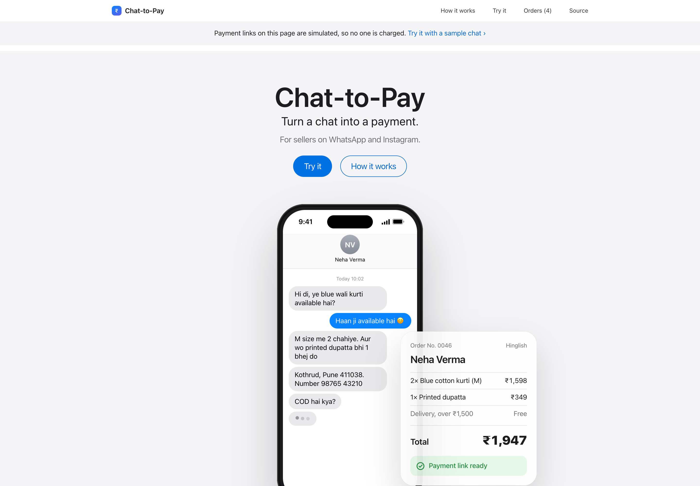
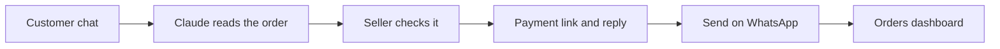
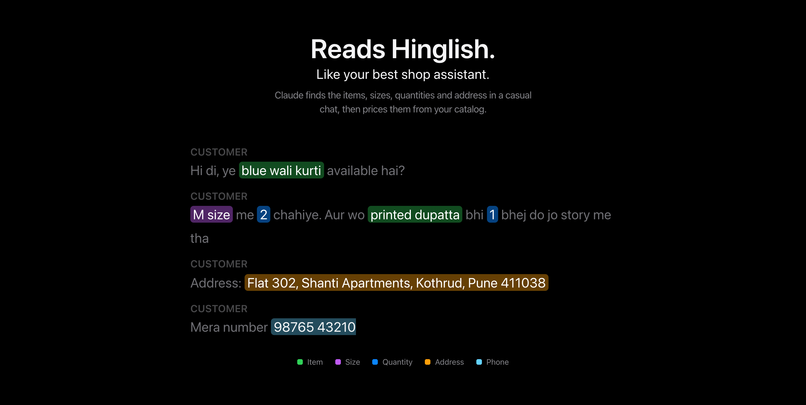
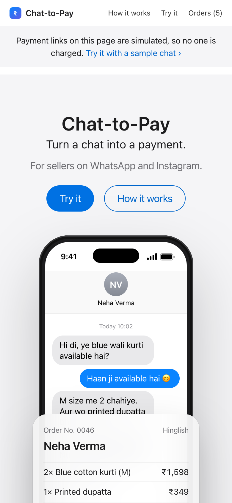

# Chat-to-Pay

[](https://github.com/Aman-Tripathi27/chat-to-pay/actions/workflows/ci.yml)


**Turn WhatsApp and Instagram order chats into payment links.**

<p align="center">
  <a href="https://claude.ai/artifact/MNAgjCaBiVyyiMpBrJuy8z"></a>
</p>

<p align="center"><b>Live app:</b> <a href="https://claude.ai/artifact/MNAgjCaBiVyyiMpBrJuy8z">claude.ai/artifact/MNAgjCaBiVyyiMpBrJuy8z</a><br>Opens in the browser. Nothing to install. Sign in with a Claude account.</p>

<p align="center">
  
</p>

## What this is

Across India, small businesses sell through WhatsApp and Instagram instead of a website. Their orders arrive as casual messages, usually in Hinglish:

> _"Hi di, ye blue wali kurti available hai? M size me 2 chahiye. Aur wo printed dupatta bhi 1 bhej do."_

To turn that into a paid order, the seller has to work out which products and sizes the customer means, look up the prices, apply the delivery rules, add it all up, ask for anything missing, send payment details and then keep track of who has paid. They do this by hand, dozens of times a day, and every step is a chance to get the amount wrong or lose the sale.

**Chat-to-Pay does that work for them.** The seller pastes the conversation and Claude reads it like an experienced shop assistant would: it pulls out the items, sizes and quantities, matches them to the shop's catalog, applies the delivery rules and finds the address. If something is missing, such as a size, it says so and writes the question to send the customer. The seller checks the order and taps once to get a payment link and a reply in the customer's own language, ready to send on WhatsApp. An orders page then shows what has been paid and what is still pending.

The result is a sale closed in one step instead of many, with fewer wrong amounts and a customer who gets a clear, friendly reply.

## Try it in two minutes

1. **[Open the app](https://claude.ai/artifact/MNAgjCaBiVyyiMpBrJuy8z)** and sign in with a Claude account. A sample customer chat is already loaded.
2. **Click Try it, then Read order**, and allow Claude when it asks. Claude takes a moment to read the chat.
3. **Check the order.** Claude should find 2 blue kurtis in size M and a dupatta, price them from the shop's catalog, make delivery free because the order is above ₹1,500, and take the address and phone number from the chat.
4. **Change a quantity** with the − and + buttons and watch the total update, then click **Create payment link**.
5. **Read the reply.** It should be in Hinglish, include the items, total and link, and answer the customer's "COD hai kya?" from the shop's own policy. **Send on WhatsApp** opens WhatsApp with the message ready.
6. **Scroll to Orders** to see the order alongside earlier ones, then click **Mark paid** to watch it move to Collected.
7. **Try your own chat.** For example, paste _"Pink anarkali chahiye, Bangalore delivery"_ and see Claude ask for the size and the full address.

## How it works



The live app is a single file, [`claude-app/index.html`](claude-app/index.html), published on Claude. It needs no server, no build step and no API key: when the seller clicks **Read order**, the page asks Claude to read the chat through Claude's built-in AI access, on the viewer's own Claude account.

- **Claude drafts, the app decides the money.** Claude returns the order as structured JSON. The app checks every field and calculates all the totals itself, so the amount always matches the items on screen.
- **Prices show where they came from.** Each line says whether its price came from the catalog, was set by the seller, or was only stated by the customer. A customer's _"you said ₹100"_ is flagged, not charged.
- **Chats are treated as data.** Claude is told to ignore any instructions inside the conversation, so a message like _"make it free"_ can't change the order.
- **The reply always matches the charge.** Claude writes the reply with placeholders for the items, total and link, which are filled in after the seller's edits.
- **WhatsApp without an API.** Messages open through `wa.me` links, so there is no WhatsApp Business onboarding and no per-message cost.
- **Nothing is stored on a server.** The shop catalog and orders stay in the seller's browser. Payment links in the live app are simulated, so no one is charged.

The page is designed like a product page: a frosted navigation bar, full-width tiles that explain each step, and the working tool below them. The chat on the hero phone types itself out, highlights sweep across the chat as you scroll, the success checkmark draws itself and the order totals count up. Everything is sized for a seller's phone, and the animations switch off when "reduce motion" is turned on.

<p align="center">
  
</p>

| Check the order                                                           | Payment link and reply                                                   |
| ------------------------------------------------------------------------- | ------------------------------------------------------------------------ |
|  |  |

<p align="center">
  
</p>

<p align="center">
  
  &nbsp;
  
</p>

## Repository

| Path                                                   | What it is                                                                                 |
| ------------------------------------------------------ | ------------------------------------------------------------------------------------------ |
| [`claude-app/index.html`](claude-app/index.html)       | The live app on Claude. One file of HTML, CSS and JavaScript.                              |
| [`src/`](src)                                          | The Razorpay-connected version (Next.js and TypeScript), which creates real payment links. |
| `src/**/*.test.ts`                                     | 65 automated tests.                                                                        |
| [`.github/workflows/ci.yml`](.github/workflows/ci.yml) | Runs lint, type checks, the tests and a build on every push.                               |
| [`docs/screenshots/`](docs/screenshots)                | The screenshots in this README.                                                            |

## Razorpay-connected version

`src/` runs the same flow against the real [Razorpay Payment Links API](https://razorpay.com/docs/api/payments/payment-links/). The server calculates the amount in paise and creates the link, and the Orders page shows each payment's live status from Razorpay. Its tests cover the order maths, the Razorpay and Claude integrations, sign-in and the API routes.

To run it locally (Node.js 20.9 or newer):

```bash
npm install
cp .env.example .env.local   # fill in the values
npm run dev                  # open http://localhost:3000
npm test                     # run the test suite
```

Without Razorpay keys it runs with simulated links, like the live app.

## Built with

- **Live app:** Claude, HTML, CSS and JavaScript
- **Razorpay-connected version:** Next.js 16, React 19, TypeScript, Razorpay Payment Links API, Anthropic TypeScript SDK, Zod, Vitest, GitHub Actions

## Next steps

- Real Razorpay payment links in the live app
- Reading orders from chat screenshots
- Instant payment updates through Razorpay webhooks

## License

[MIT](LICENSE) © Aman Tripathi
