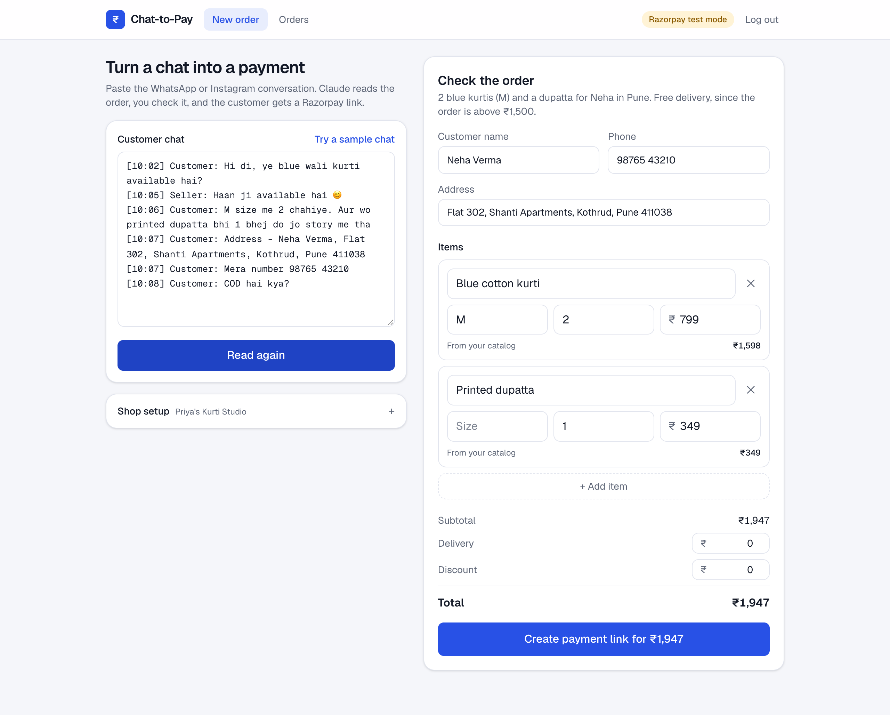
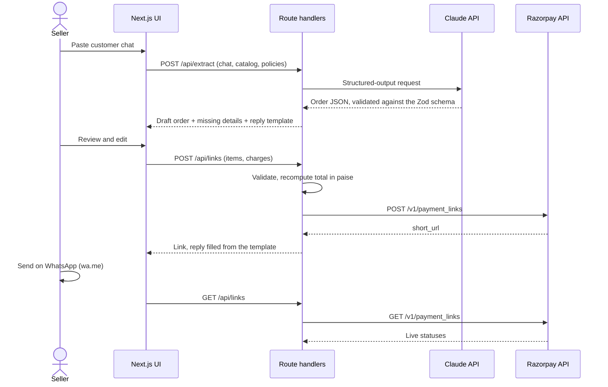

# Chat-to-Pay

[](https://github.com/Aman-Tripathi27/chat-to-pay/actions/workflows/ci.yml)


**Turn WhatsApp and Instagram order chats into Razorpay payment links.**

Small sellers in India take most of their orders in DMs: _"M size me 2 chahiye, aur wo dupatta bhi bhej do."_ Then they retype the order, work out the total by hand, send their UPI ID and wait for a payment screenshot. Chat-to-Pay turns that into one step. Paste the conversation, check the order Claude extracts, and send the customer a Razorpay payment link with a reply written in their own language.

<p align="center">
  
</p>

## Features

- **Reads real customer chats.** Hinglish, Hindi and English in, structured order out: items, sizes, quantities, catalog prices, delivery charges (including free-delivery thresholds) and the address.
- **Flags what's missing.** If the size or address isn't in the chat, the seller sees a warning and a ready-to-send question in the customer's language.
- **Shows where each price came from.** Every line is marked as from the catalog, set by the seller, or claimed by the customer, so a "you said ₹100" never slips through.
- **Creates Razorpay Payment Links.** The server computes the amount in paise, tags the link and gives it a 7-day expiry.
- **Hands off to WhatsApp.** A `wa.me` deep link opens the chat with the reply and link filled in. No WhatsApp Business API is needed.
- **Tracks orders.** The dashboard shows collected and pending amounts and the paid rate, with live status from Razorpay and one-tap reminders for unpaid links.
- **Fits a seller's day.** Mobile-first, with light and dark themes, behind a password. Without Razorpay keys it runs locally in demo mode.

| Payment link and reply                                                   | Orders dashboard                                                         |
| ------------------------------------------------------------------------ | ------------------------------------------------------------------------ |
|  |  |

<p align="center">
  
</p>

## How it works



### Design decisions

- **Razorpay is the source of truth.** There is no database. Each order is a Payment Link tagged with `notes.source = "chat-to-pay"`, and the dashboard reads status straight from Razorpay. Nothing has to be kept in sync, and nothing goes stale.
- **The model drafts; the server decides the money.** Claude proposes the order, the seller confirms it, and the server validates the items with Zod and computes the amount itself. The browser and the model never set the charge.
- **Typed end to end.** One Zod schema (`src/lib/order.ts`) drives Claude's structured output, the TypeScript types and runtime validation.
- **Chats are untrusted input.** The conversation is passed as tagged data. The prompt tells Claude to ignore instructions inside it, and prices that only the customer stated are flagged for the seller to confirm.
- **Replies always match the charge.** Claude writes the reply with `{{ITEMS}}`, `{{TOTAL}}` and `{{LINK}}` placeholders, filled in after the seller's edits.
- **No API costs for messaging.** Sending through `wa.me` links avoids WhatsApp Business API onboarding and per-message fees.

## Tech stack

| Area      | Choice                                                            |
| --------- | ----------------------------------------------------------------- |
| Framework | Next.js 16 (App Router, Route Handlers, Proxy), React 19          |
| Language  | TypeScript (strict)                                               |
| AI        | Anthropic TypeScript SDK, Claude Opus 5.5 with structured outputs |
| Payments  | Razorpay Payment Links REST API                                   |
| UI        | Tailwind CSS 4, Geist                                             |
| Quality   | Zod 4, Vitest, ESLint, Prettier, GitHub Actions                   |

## Getting started

**You need:** Node.js 20.9 or newer (22 recommended, see `.nvmrc`), an [Anthropic API key](https://platform.claude.com/settings/keys) and a [Razorpay](https://dashboard.razorpay.com) account in test mode.

```bash
git clone https://github.com/Aman-Tripathi27/chat-to-pay.git
cd chat-to-pay
npm install
cp .env.example .env.local   # fill in the values below
npm run dev
```

Open http://localhost:3000 and sign in with your `APP_PASSWORD`. Click **Try a sample chat**, then **Read order**.

| Variable              | Description                                                                                     |
| --------------------- | ----------------------------------------------------------------------------------------------- |
| `APP_PASSWORD`        | Password for the app. Use a long one: the dashboard shows customer phone numbers and addresses. |
| `ANTHROPIC_API_KEY`   | Claude API key from the Claude Console.                                                         |
| `RAZORPAY_KEY_ID`     | Razorpay Dashboard → Account & Settings → API Keys. Use test keys (`rzp_test_…`) first.         |
| `RAZORPAY_KEY_SECRET` | The secret shown with the key ID.                                                               |

**Test a payment end to end:** with test keys, create a link, open it, and pay with the UPI ID `success@razorpay`. The order moves to **Paid** on the Orders page.

**Demo mode:** if the Razorpay keys are empty, the app creates links on the reserved `demo-link.invalid` domain and keeps them in memory, so you can try the full flow without a Razorpay account. The header shows which mode the server is in.

## Scripts

| Command             | What it does                                    |
| ------------------- | ----------------------------------------------- |
| `npm run dev`       | Start the dev server                            |
| `npm run build`     | Production build                                |
| `npm start`         | Serve the production build                      |
| `npm test`          | Run the test suite                              |
| `npm run typecheck` | Generate route types and run `tsc`              |
| `npm run lint`      | ESLint                                          |
| `npm run format`    | Format with Prettier (`format:check` to verify) |

## Testing

65 Vitest tests cover the parts where mistakes cost money or leak data:

- **Order maths:** totals, rounding to the paisa, discounts never going below zero, Indian number formatting.
- **Razorpay client:** amounts in paise, notes within Razorpay's limits, reference IDs, expiry window, basic auth, error mapping, and filtering the list API down to this app's links.
- **Claude integration:** request shape, refusal and truncation handling, and auth and rate-limit errors, with the SDK mocked.
- **Auth:** password checks, session tokens, and sessions ending when the password changes.
- **API routes:** sign-in cookies, 401s without a session, and field-level validation errors.

External APIs are mocked, so the suite runs offline in under a second. [CI](.github/workflows/ci.yml) runs lint, format check, typecheck, tests and a production build on every push and pull request.

## Project structure

```
src/
├── app/
│   ├── (app)/              # Signed-in pages: New order (/) and Orders (/orders)
│   ├── api/
│   │   ├── extract/        # POST: chat → structured order (Claude)
│   │   ├── links/          # POST: create a payment link · GET: list orders (Razorpay)
│   │   ├── login/, logout/ # Session cookie
│   │   └── status/         # Which Razorpay mode the server runs in
│   └── login/
├── components/             # NewOrder, OrdersDashboard, AppHeader and hooks
├── lib/
│   ├── auth.ts             # Password check and HMAC-signed session cookies
│   ├── extract.ts          # Prompt, Claude request and error mapping
│   ├── order.ts            # Zod schemas, totals, phone and WhatsApp helpers
│   ├── razorpay.ts         # Payment Links client and demo mode
│   └── sample.ts           # Sample shop and chat
└── proxy.ts                # Sends signed-out visitors to /login
```

## Security

- **Sessions:** the session cookie is an HMAC-SHA256 token derived from `APP_PASSWORD`. It is `httpOnly`, `SameSite=Lax` and `Secure` in production, and is compared in constant time. Changing the password signs out every session.
- **Every API route checks the session.** The proxy only redirects signed-out pages to the login screen.
- **Secrets stay on the server.** API keys are read only in route handlers and never sent to the browser.
- **All input is validated.** Request bodies are checked with Zod, chats are capped at 20,000 characters, and the login redirect accepts only same-site paths.

## Deployment

The app deploys to [Vercel](https://vercel.com) with no extra configuration:

1. Import the repository in Vercel.
2. Add the four environment variables above under **Settings → Environment Variables**, as type **Secret**.
3. Deploy. Every push to `main` redeploys.

## Roadmap

- Razorpay webhooks (`payment_link.paid`) with signature verification, for instant status updates and seller notifications
- Sending through the WhatsApp Business Cloud API
- Reading orders from chat screenshots with Claude vision
- Multiple seller accounts, with catalogs stored on the server
- Pagination beyond the latest 100 links, and rate limiting on sign-in

## License

[MIT](LICENSE) © Aman Tripathi
