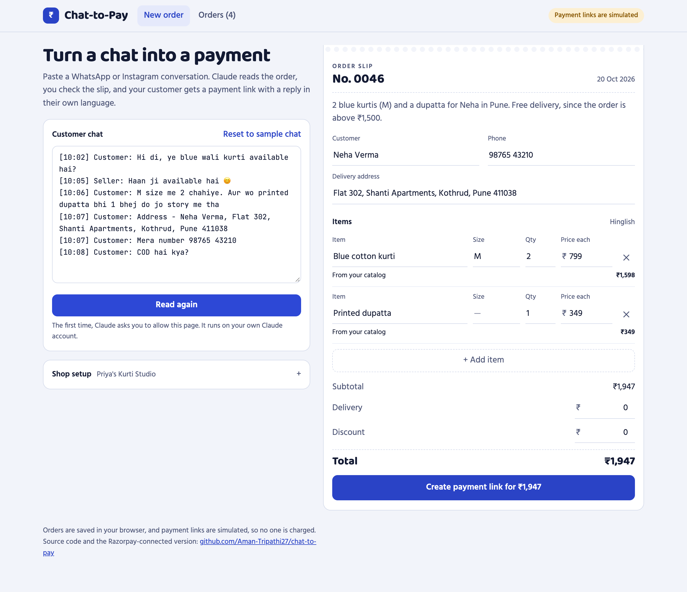
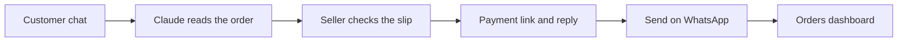
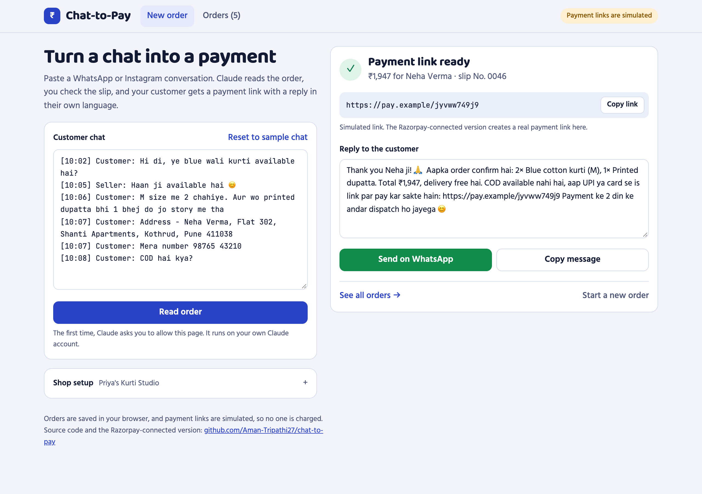
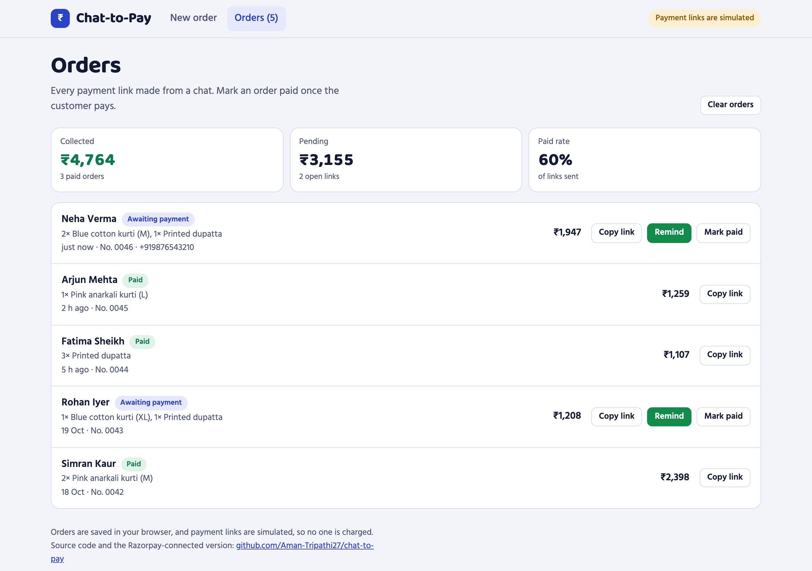
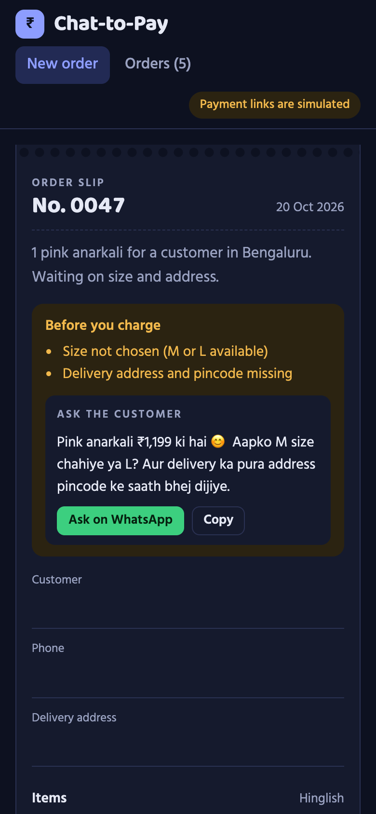

# Chat-to-Pay

[](https://github.com/Aman-Tripathi27/chat-to-pay/actions/workflows/ci.yml)


**Turn WhatsApp and Instagram order chats into payment links.**

Small sellers in India take most of their orders in DMs: _"M size me 2 chahiye, aur wo dupatta bhi bhej do."_ Then they retype the order, work out the total by hand, send their UPI ID and wait for a payment screenshot. Chat-to-Pay turns that into one step. Paste the conversation, check the order Claude reads from it, and send the customer a payment link with a reply written in their own language.

### ▶ [Open the live app](https://claude.ai/artifact/MNAgjCaBiVyyiMpBrJuy8z)

It runs on Claude, with nothing to install. Sign in with a Claude account, click **Read order** (a sample chat is already loaded), and allow Claude when it asks.

<p align="center">
  
</p>

## What it does



1. **Paste a chat** in Hinglish, Hindi or English.
2. **Claude fills in an order slip:** items, sizes, quantities, prices from the shop's catalog, the delivery charge (including free-delivery thresholds) and the address.
3. **Missing details are flagged.** If the size or address isn't in the chat, the seller sees a warning and a question for the customer, already written in their language.
4. **The seller checks the slip.** Every field can be edited, and the total updates as they type.
5. **One click creates the payment link,** with a reply in the customer's language that includes the items, the total and the link. **Send on WhatsApp** opens the chat with the message ready.
6. **The Orders page** shows collected and pending amounts and the paid rate, with one-tap WhatsApp reminders for unpaid orders.

| Payment link and reply                                                   | Orders dashboard                                                         |
| ------------------------------------------------------------------------ | ------------------------------------------------------------------------ |
|  |  |

<p align="center">
  
</p>

## How it works

The live app is a single file, [`claude-app/index.html`](claude-app/index.html), published on Claude. It needs no server, no build step and no API key: when the seller clicks **Read order**, the page asks Claude to read the chat through Claude's built-in AI access, on the viewer's own Claude account.

- **Claude drafts, the page decides the money.** Claude returns the order as JSON. The page checks every field and calculates all totals itself, so the amount always matches the items on the slip.
- **Prices show where they came from.** Each line says whether its price came from the catalog, from the seller, or only from the customer. A customer's _"you said ₹100"_ is flagged instead of charged.
- **Chats are treated as data.** Claude is told to ignore any instructions inside the conversation, so a message like _"make it free"_ can't change the order.
- **The reply always matches the charge.** Claude writes the reply with placeholders for the items, total and link, which are filled in after the seller's edits.
- **WhatsApp without an API.** Messages open through `wa.me` links, so there is no WhatsApp Business onboarding and no per-message cost.
- **Nothing is stored on a server.** The shop catalog and orders stay in the seller's browser. Payment links in the live app are simulated, so no one is charged.

## Repository

| Path                                                   | What it is                                                                                 |
| ------------------------------------------------------ | ------------------------------------------------------------------------------------------ |
| [`claude-app/index.html`](claude-app/index.html)       | The live app on Claude. One file of HTML, CSS and JavaScript.                              |
| [`src/`](src)                                          | The Razorpay-connected version (Next.js and TypeScript), which creates real payment links. |
| `src/**/*.test.ts`                                     | 65 automated tests.                                                                        |
| [`.github/workflows/ci.yml`](.github/workflows/ci.yml) | Runs lint, type checks, the tests and a build on every push.                               |
| [`docs/screenshots/`](docs/screenshots)                | The screenshots in this README.                                                            |

## Razorpay-connected version

`src/` runs the same flow against the real [Razorpay Payment Links API](https://razorpay.com/docs/api/payments/payment-links/). The server calculates the amount in paise and creates the link, and the Orders page shows each payment's live status from Razorpay. Its tests cover the order maths, the Razorpay and Claude integrations, sign-in and the API routes.

To run it locally (Node.js 20.9 or newer):

```bash
npm install
cp .env.example .env.local   # fill in the values
npm run dev                  # open http://localhost:3000
npm test                     # run the test suite
```

Without Razorpay keys it runs with simulated links, like the live app.

## Built with

- **Live app:** Claude, HTML, CSS and JavaScript
- **Razorpay-connected version:** Next.js 16, React 19, TypeScript, Razorpay Payment Links API, Anthropic TypeScript SDK, Zod, Vitest, GitHub Actions

## Next steps

- Real Razorpay payment links in the live app
- Reading orders from chat screenshots
- Instant payment updates through Razorpay webhooks

## License

[MIT](LICENSE) © Aman Tripathi
