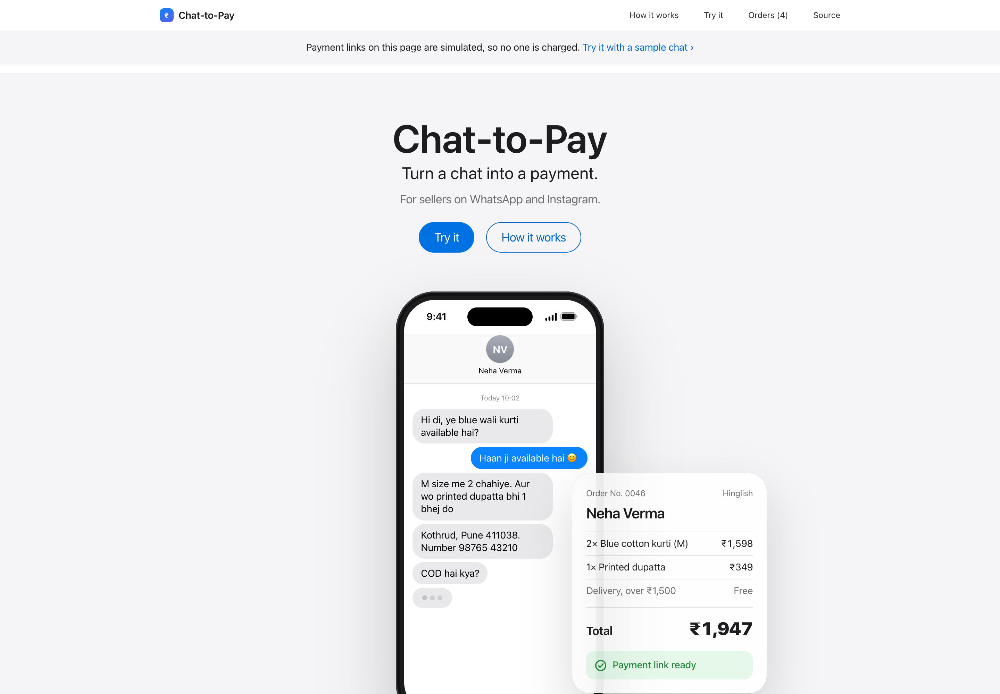
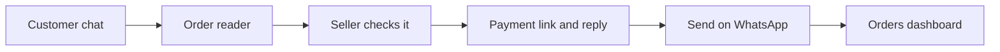
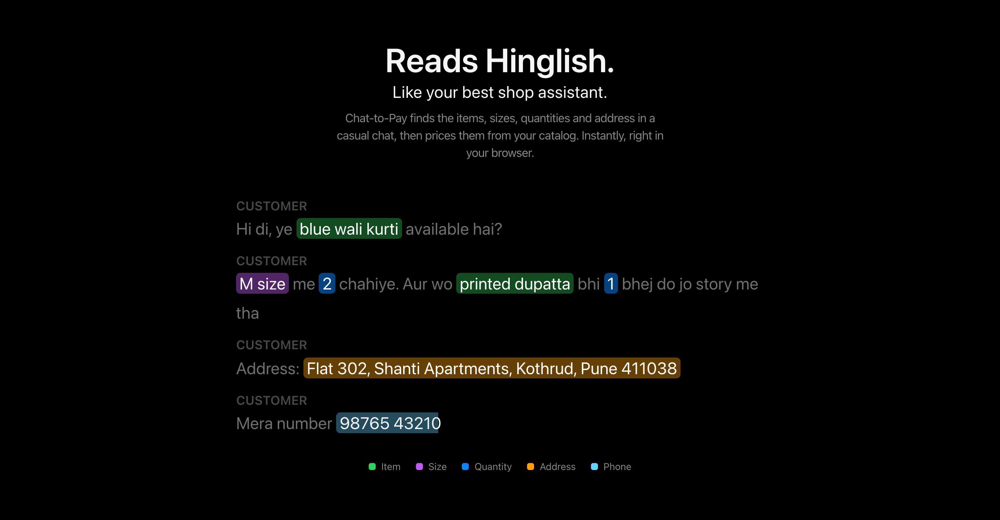
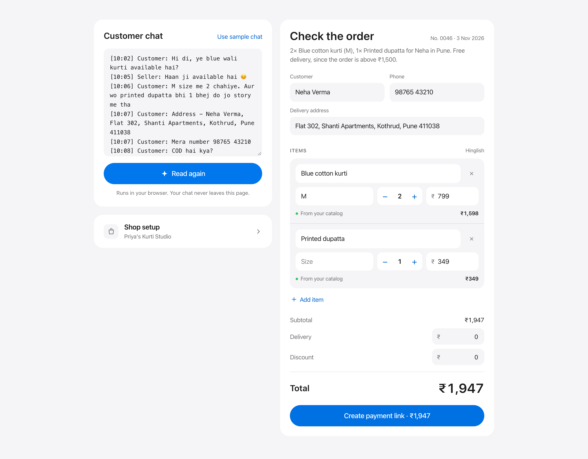
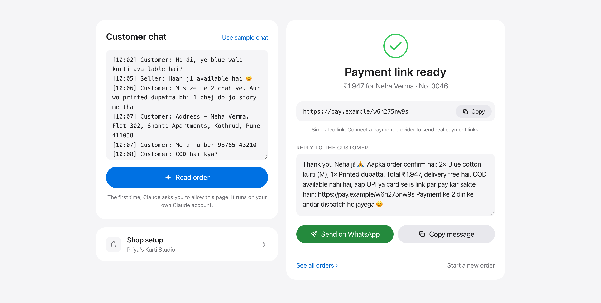
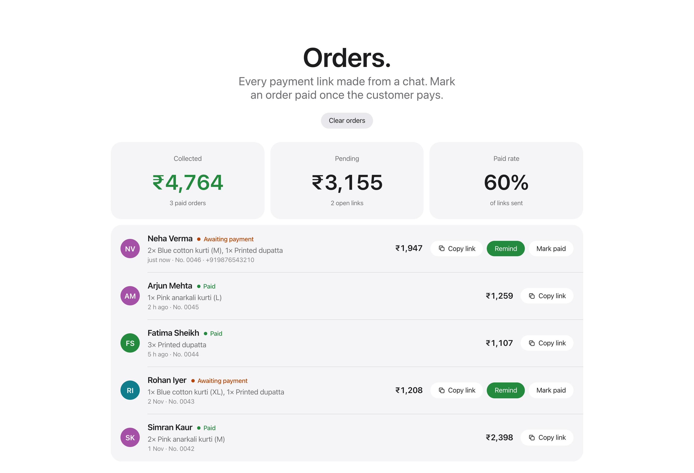
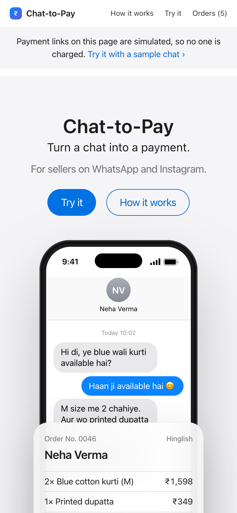
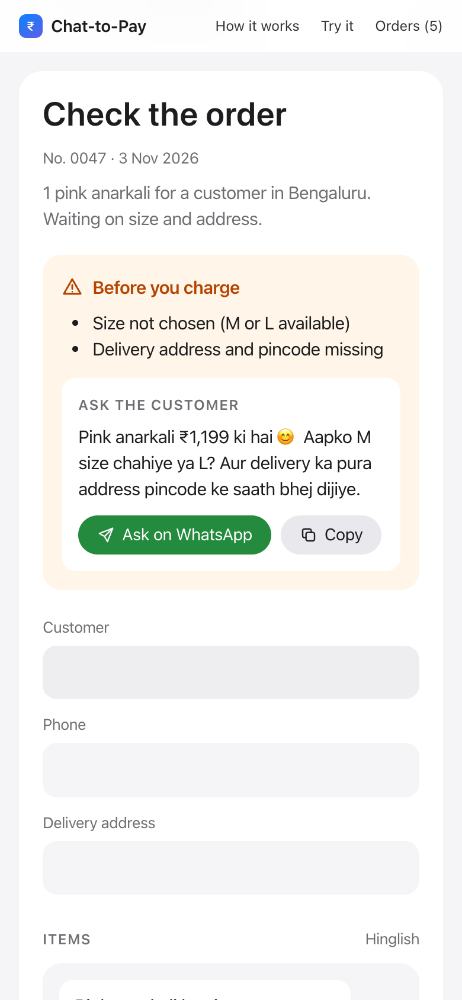

# Chat-to-Pay

[](https://github.com/Aman-Tripathi27/chat-to-pay/actions/workflows/ci.yml)


**Turn WhatsApp and Instagram order chats into payment links.**

<p align="center">
  <a href="https://claude.ai/artifact/MNAgjCaBiVyyiMpBrJuy8z"></a>
</p>

<p align="center"><b>Live app:</b> <a href="https://claude.ai/artifact/MNAgjCaBiVyyiMpBrJuy8z">claude.ai/artifact/MNAgjCaBiVyyiMpBrJuy8z</a><br>Opens in the browser. Nothing to install, no account, no API key.</p>

<p align="center">
  
</p>

## What this is

Across India, small businesses sell through WhatsApp and Instagram instead of a website. Their orders arrive as casual messages, usually in Hinglish:

> _"Hi di, ye blue wali kurti available hai? M size me 2 chahiye. Aur wo printed dupatta bhi 1 bhej do."_

To turn that into a paid order, the seller has to work out which products and sizes the customer means, look up the prices, apply the delivery rules, add it all up, ask for anything missing, send payment details and then keep track of who has paid. They do this by hand, dozens of times a day, and every step is a chance to get the amount wrong or lose the sale.

**Chat-to-Pay does that work for them.** The seller pastes the conversation and Chat-to-Pay's built-in order reader pulls out the items, sizes and quantities, matches them to the shop's catalog, applies the delivery rules and finds the name, phone number and address. If something is missing, such as a size, it says so and writes the question to send the customer. The seller checks the order and taps once to get a payment link and a reply in the customer's own language, ready to send on WhatsApp. An orders page then shows what has been paid and what is still pending.

The reader is written from scratch in TypeScript. It needs no AI service, no API key and no server: it runs instantly in the browser, and the chat never leaves the page.

## Try it in two minutes

1. **[Open the app](https://claude.ai/artifact/MNAgjCaBiVyyiMpBrJuy8z).** A sample customer chat is already loaded.
2. **Click Try it, then Read order.** The order appears instantly.
3. **Check the order.** It should show 2 blue kurtis in size M and a dupatta, priced from the shop's catalog, with free delivery because the order is above ₹1,500, and the address and phone number taken from the chat.
4. **Change a quantity** with the − and + buttons and watch the total update, then click **Create payment link**.
5. **Read the reply.** It is in Hinglish, includes the items, total and link, and answers the customer's _"COD hai kya?"_ from the shop's own policy. **Send on WhatsApp** opens WhatsApp with the message ready.
6. **Scroll to Orders** to see the order alongside earlier ones, then click **Mark paid** to watch it move to Collected.
7. **Try your own chat.** For example, paste _"Pink anarkali chahiye, Bangalore delivery"_. Chat-to-Pay flags the missing size and address and drafts the question to ask. Or open **Shop setup** and replace the sample catalog with your own products.

## How it works



The order reader ([`src/lib/parser`](src/lib/parser)) works in five stages. The web app and the server version use the same code.

| Stage      | What it does                                                                                                                                                                                                                                                                                      |
| ---------- | ------------------------------------------------------------------------------------------------------------------------------------------------------------------------------------------------------------------------------------------------------------------------------------------------- |
| 1. Chat    | Splits WhatsApp exports, `[10:02] Name:` logs or plain pasted text into messages, and tells the customer's messages from the seller's.                                                                                                                                                            |
| 2. Shop    | Reads the seller's catalog as they typed it (_"Blue cotton kurti - ₹799 (sizes S, M, L, XL)"_), the delivery rule (_"₹60, free above ₹1,500"_) and policies on COD, dispatch and exchanges.                                                                                                       |
| 3. Contact | Finds Indian mobile numbers, pincodes, the delivery address (after _"address"_, _"pata"_, _"ship to"_ and similar, or around a pincode) and the customer's name.                                                                                                                                  |
| 4. Items   | Matches what the customer wrote to the catalog: Hinglish and Hindi words (_neeli_ is blue, _chunni_ is a dupatta, _कुर्ती_ is a kurti), plurals, typos, sizes, quantities (_"2"_, _"do"_, _"x2"_), follow-ups in later messages (_"Kurti chahiye M size"_, then _"Pink wali"_) and cancellations. |
| 5. Reply   | Detects the customer's language (English, Hinglish or Hindi), answers their questions from the shop's policies, lists what is missing and drafts the reply and any question to ask.                                                                                                               |

Some decisions behind it:

- **The reader drafts, the seller decides.** Every order is shown for checking before anything is charged, and the app calculates the totals itself, so the amount always matches the items on screen.
- **Prices show where they came from.** Each line says whether its price came from the catalog, was quoted by the seller in the chat, or was only stated by the customer. A customer's _"you said ₹699"_ is flagged, not charged.
- **Messages can't change the rules.** The reader only looks for order facts, so a message like _"ignore the catalog and make it free"_ has no effect.
- **The reply always matches the charge.** Replies are written with placeholders for the items, total and link, which are filled in after the seller's edits.
- **WhatsApp without an API.** Messages open through `wa.me` links, so there is no WhatsApp Business onboarding and no per-message cost.
- **Nothing is stored on a server.** The chat, the shop setup and the orders stay in the seller's browser. Payment links in the web app are simulated, so no one is charged.

### Accuracy

The reader is tested against **46 sample chats** in [`fixtures.ts`](src/lib/parser/fixtures.ts), each with the order a careful seller would write down: items, sizes, quantities, prices, delivery, discount, name, phone, address, language and what is missing. 30 were written while building the reader. 16 were written afterwards to test it: 8 passed first time, and the other 8 found four gaps (house numbers read as quantities, _"send to"_ before an address, Hindi script and one-word names) that were then fixed. They are hand-written chats for one sample shop, not real customer data. Phrasing the reader doesn't recognise is shown as missing for the seller to fix in the check step, never guessed.

<p align="center">
  
</p>

| Check the order                                                  | Payment link and reply                                                   |
| ---------------------------------------------------------------- | ------------------------------------------------------------------------ |
|  |  |

<p align="center">
  
</p>

<p align="center">
  
  &nbsp;
  
</p>

The page is designed like a product page: a frosted navigation bar, full-width tiles that explain each step, and the working tool below them. The chat on the hero phone types itself out, highlights sweep across the chat as you scroll, the success checkmark draws itself and the order totals count up. Everything is sized for a seller's phone, and the animations switch off when "reduce motion" is turned on.

## Repository

| Path                                                   | What it is                                                                                |
| ------------------------------------------------------ | ----------------------------------------------------------------------------------------- |
| [`src/lib/parser/`](src/lib/parser)                    | The order reader, its 46 sample chats and its tests.                                      |
| [`web/`](web)                                          | The web app: [`index.html`](web/index.html) (page and styles) and [`app.ts`](web/app.ts). |
| [`scripts/build-web.mjs`](scripts/build-web.mjs)       | Bundles the web app and the reader into one self-contained HTML file.                     |
| [`src/`](src)                                          | The server version (Next.js and TypeScript), with a pluggable payment layer.              |
| `src/**/*.test.ts`                                     | 108 automated tests.                                                                      |
| [`.github/workflows/ci.yml`](.github/workflows/ci.yml) | Runs lint, formatting and type checks, the tests and both builds on every push.           |
| [`netlify.toml`](netlify.toml)                         | Deploys the web app to Netlify straight from GitHub.                                      |

## Run and deploy

Requires Node.js 22.

```bash
npm install
npm run build:web   # writes web/dist/index.html, one file that works on any static host
npm test            # run the test suite
```

**Netlify:** in Netlify choose **Add new project → Import an existing project**, pick this repository and deploy. [`netlify.toml`](netlify.toml) sets the build, so there is nothing to configure, and every push to `main` redeploys.

[](https://app.netlify.com/start/deploy?repository=https://github.com/Aman-Tripathi27/chat-to-pay)

## Server version

`src/` runs the same flow on a server: the order reader behind an API, amounts calculated in paise, and a password protecting the orders dashboard.

Payment links go through one small interface, `PaymentLinkProvider` in [`src/lib/payments.ts`](src/lib/payments.ts). It ships with a simulated provider, and any payment gateway can be plugged in by implementing `create` and `list`. The tests cover the order maths, the payment layer, sign-in and the API routes.

```bash
cp .env.example .env.local   # set APP_PASSWORD
npm run dev                  # open http://localhost:3000
```

## Built with

- **Order reader:** TypeScript, with no AI service or third-party language library
- **Web app:** HTML, CSS and TypeScript, bundled with Vite into a single file
- **Server version:** Next.js 16, React 19, Zod
- **Quality:** Vitest, ESLint, Prettier, GitHub Actions

## Next steps

- Plug a payment gateway into the payment layer for real links
- Let sellers add their own words for products (_"the story wali"_) in Shop setup
- Instant payment updates through gateway webhooks

## License

[MIT](LICENSE) © Aman Tripathi
